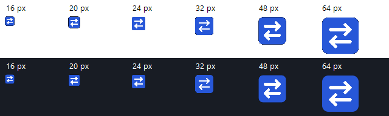

# Magic Language Switcher

[](https://github.com/siarheisinelnikau/magic-language-switcher/actions/workflows/ci.yml)
[](https://github.com/siarheisinelnikau/magic-language-switcher/releases/latest)
[](LICENSE)

A lightweight **Windows app** that fixes text typed in the wrong keyboard layout with one hotkey. Written in Rust, with a compact native interface and a **single portable EXE**.

`ghbdtn vbh` → `привет мир` is one example. Conversion uses the keyboard layouts installed in Windows, rather than a hardcoded English/Russian pair.

**[Download Windows x64 — v0.1.3](https://github.com/siarheisinelnikau/magic-language-switcher/releases/download/v0.1.3/MagicLanguageSwitcher-v0.1.3.exe)** · [Release notes](https://github.com/siarheisinelnikau/magic-language-switcher/releases/tag/v0.1.3) · [Report an issue](https://github.com/siarheisinelnikau/magic-language-switcher/issues)


*The application settings window: choose layouts, customize correction and undo, and try a conversion without leaving the app.*

## What it does

- **One correction shortcut:** convert the selection, or the last word when nothing is selected.
- **Separate undo:** restore the last correction while the text and caret still match.
- **Installed Windows layouts:** select any supported direct-key layout pair, including variants and AltGr mappings.
- **Compact native UI:** editable shortcuts, a live preview, optional Windows startup, and an active-language tray icon.
- **Portable Rust app:** one EXE with in-app GitHub update checks, verified downloads, and restart.

## Get started

1. Download the EXE from [Releases](https://github.com/siarheisinelnikau/magic-language-switcher/releases/latest). The v0.1.3 file is **`MagicLanguageSwitcher-v0.1.3.exe`**, a Windows x64 build.
2. Put it in a folder you want to keep and run it. No installer, .NET, browser engine, or VC++ redistributable is needed.
3. Select mistyped text, or leave the caret after a mistyped word, and press **F8**. The same key handles both cases.

Requires **Windows 10 version 1607 or newer, or Windows 11, x64**. The release is unsigned.

## Shortcuts

| Default shortcut | Action |
| --- | --- |
| **F8** | Convert selected text; if nothing is selected, convert the last word |
| **Ctrl+F8** | Undo the last correction immediately, in the same editor |

**To change a shortcut:** click its button in settings, press the new combination, and release the keys to save. **Esc** cancels; **Backspace** restores that action's default. There are just two actions: **Correct text** and **Undo**.

Existing last-word and undo bindings are retained when upgrading from earlier releases. The separate selection binding is retired. If selected text cannot be copied or converted, the app leaves it selected rather than falling back to a different word.

Use Ctrl, Alt, and/or Shift with a key, function keys (except Windows-reserved F12), or supported toggle keys such as Pause, Caps Lock, and Scroll Lock. Ordinary typing keys need Ctrl or Alt. Windows-key shortcuts are not supported. Avoid Ctrl+Alt combinations that overlap AltGr characters in your keyboard layout.

Each action needs a distinct shortcut. If a combination belongs to another app, or settings cannot be saved, the previous binding stays active. Recording ends when you leave the settings window. Preferences survive restart and changes to the conversion layouts.

Undo checks that the text before the caret still matches the last correction. If the text or caret has changed, it refuses to replace anything. A selection can contain up to **4,096 UTF-16 code units**, including line breaks and tabs.

The system tray icon shows the active language. It stays in the tray; nothing follows your mouse or text caret. Click the icon to open settings, or right-click for pause/resume, update checks, and quit. Closing the settings window keeps the app running in the tray.

## Choose any installed keyboard layout

The **From** and **To** lists come from Windows and distinguish layout variants, such as US and Dvorak. Direct character mappings include Shift and AltGr states.

- **From → Auto (active layout)** detects the source by character coverage. If several layouts can produce the same letters, the active layout wins the tie.
- **To → Next installed layout** cycles from the detected source to the next layout in Windows' list. With two installed layouts, it switches between them.
- Choose explicit **From** and **To** entries for a fixed pair. This is useful for layouts sharing an alphabet, such as US QWERTY, German QWERTZ, and French AZERTY.

Add additional keyboards in Windows language settings, then reopen the app's settings window to refresh the lists. The app does not install languages or change the Windows language list. After a correction, it requests the destination layout for the active editor.

This is physical-key conversion, not translation or transliteration. **IME candidate composition** and **multi-key dead-key composition** cannot be reconstructed from committed text. Characters without a direct mapping remain unchanged. For ambiguous text, choose the source explicitly.

## A few settings

- **Pause** temporarily disables correction shortcuts; the language icon remains available.
- **Start with Windows** adds this EXE to your own user's startup entries. Keep the EXE in its final folder before enabling it; disable the option before moving or deleting it.
- Layout choices and shortcuts are saved in `%LOCALAPPDATA%\MagicLanguageSwitcher\settings.conf`.
- Run with `--background` to start directly in the tray.
- **About** contains the installed version, project link, manual update check, startup-check toggle, and an expandable MIT license.

## Updates

Open **About → Check for updates**, or choose **Check for updates** from the tray menu. The app checks the latest stable release on this GitHub repository. When a newer Windows x64 release is available, choose **Download and install**. The existing settings window shows download percentage, transferred size, verification, and restart progress.

The download runs in the background over HTTPS. Before installing, the app checks the file size, Windows x64 header, and SHA-256 against both GitHub release metadata and `SHA256SUMS.txt`. Failed checks leave the current EXE in place. Once verified, a temporary copy of the current app waits for shutdown, replaces the EXE with a backup, and starts the new version. Settings, startup entries, and the existing EXE path are retained, including its filename. Temporary update files are removed after restart.

Keep the EXE in a folder your Windows user can write to. The updater does not request administrator access. Checks and downloads require an internet connection; errors and GitHub rate limits are shown in the app. **Check for updates on startup** is enabled by default and can be disabled in About. Startup checks run in the background; no-update results and transient errors show no dialog. A newer release produces a tray notification. Disabling the option prevents startup requests while keeping manual checking available. Downloads and installation always require your action.

**Filename transition:** v0.1.2 recognizes only the historical `-windows-x64.exe` asset name. To upgrade from v0.1.2 to v0.1.3, download the new EXE manually once, quit the old app, and replace the EXE at its existing path to keep startup shortcuts working. Settings are stored separately and are retained. v0.1.3 accepts both naming conventions for future updates. Versions before v0.1.2 also require a manual download to gain the updater.

## Privacy and compatibility

Text correction works offline. The app contacts GitHub for the startup check when enabled and when you request a manual check or download; typed text is never sent. It has no telemetry, network service, continuous keyboard hook, or typing log. A temporary keyboard hook runs only while you explicitly record a shortcut and is removed afterward. The app reads text only when you invoke a correction and keeps one undo record in memory.

Correction temporarily uses the clipboard to read selected text; multiline text is pasted back as plain text. Clipboard payload formats, including images and rich text, are duplicated and restored, and a newer clipboard value is not overwritten. Owner-specific OLE transport handles are excluded; their advertised data formats are preserved. Windows clipboard history or clipboard managers may retain the temporary text. Unusual app-owned clipboard formats can prevent a correction if they cannot be preserved.

Use an editable field that supports normal selection and copy/paste. Selection detection uses native edit messages and Windows UI Automation, with a clipboard probe when an editor exposes neither. Editors that copy entire lines without exposing their selection state may not support automatic fallback. Password fields exposed by Windows are excluded. Read-only controls, games, terminals, custom editors, and apps running as administrator may reject or reinterpret input. Text formatting is not preserved when replacing a rich-text selection. If a global shortcut is already registered by another app, choose a different combination in settings.

## Build from source

On Windows, install the [Rust MSVC toolchain](https://www.rust-lang.org/tools/install), Visual Studio C++ Build Tools, and the Windows SDK. Rust **1.95 or newer** is required; current stable Rust is recommended. Keep `rust-auto-updator` beside this repository: Cargo uses `../rust-auto-updator/crates/rust-auto-updator` for the shared update engine. Standalone checkouts and CI runners must provision that sibling workspace first; it is currently a local dependency rather than a published registry package.

```powershell
git clone https://github.com/siarheisinelnikau/magic-language-switcher.git
cd magic-language-switcher
cargo build --release --locked
```

The executable is `target\release\magic-language-switcher.exe`. The MSVC runtime is linked statically through `.cargo/config.toml`; the icon, manifest, version information, and license are embedded. Only Windows system DLLs are required.

Package the executable with the release naming convention:

```powershell
powershell -NoProfile -ExecutionPolicy Bypass -File tools/package-release.ps1
```

This builds a Windows x64 EXE, checks its PE imports, and writes `MagicLanguageSwitcher-vVERSION.exe` and `SHA256SUMS.txt` to `artifacts\vVERSION\`, using the Cargo package version. The checksum file names the exact packaged EXE. For a source package with version 0.1.3:

```powershell
Get-FileHash .\artifacts\v0.1.3\MagicLanguageSwitcher-v0.1.3.exe -Algorithm SHA256
```

## Tests

```powershell
cargo fmt --all -- --check
cargo clippy --locked --all-targets --all-features -- -D warnings
cargo test --locked --all-features
```

### CPU rendering and responsiveness

The current source renders the settings background on the CPU into a retained 32-bit bitmap. GDI copies only the invalid rectangle to the window; controls and ClearType text stay native to Windows. The application does not create an OpenGL, Direct3D, or Vulkan rendering context. Windows desktop composition remains an operating-system responsibility.

There is no continuous render loop. An unchanged background reuses its pixels; size, DPI, or scene changes rebuild them. Hidden and minimized windows skip presentation. Reopening settings reuses keyboard mappings while the installed layout IDs are unchanged, and unchanged control text is not sent for redraw. DPI changes update bounds and fonts before scheduling a single complete repaint.

The executable embeds native 16, 20, 24, 32, 48, 64, 128, and 256-pixel app icons. The window assigns a separate small icon, and the dynamic language tray icon is drawn at the system's current small-icon metric instead of shrinking a fixed 32-pixel image. `tools/verify-icons.ps1 -Executable target/release/magic-language-switcher.exe -Output target/icon-proof.png` checks and renders the final EXE resources without launching the app. This proof does not certify actual OS tray appearance or mixed-monitor interaction.



For the opt-in release-build latency and repaint profile, see [UI performance checks](docs/ui-performance.md). It reports callback timing, CPU raster/upload counts, and visible/hidden idle paints without injecting global input or changing your clipboard.

Pure conversion tests also run on Linux. The shared updater workspace owns version comparison, repository-bound release validation, integrity checks, and replacement regressions. An isolated Windows integration test replaces a temporary EXE and verifies restart and cleanup without touching the installed app. The opt-in Windows desktop test starts an isolated native editor and the real app, exercises the actual global shortcuts, and restores the clipboard afterward. It requires an unlocked desktop, installed US English and Russian layouts for its known examples, and no running app instance:

```powershell
cargo test --locked --features desktop-tests --test desktop -- --ignored --test-threads=1 --nocapture
cargo test --locked --all-features failed_persistence -- --ignored --test-threads=1
```

## Project structure

| Path | Purpose |
| --- | --- |
| `src/layout.rs` | Layout-independent physical-key conversion and source selection |
| `src/shortcuts.rs` | Shortcut values, validation, and English key names |
| `src/platform/hotkeys.rs` | Registration, conflict rollback, and temporary shortcut recording |
| `src/platform/keyboard.rs` | Installed layout discovery and Windows keyboard tables |
| `src/platform/correction.rs` | Correction and verified undo |
| `src/platform/selection.rs` | Native and UI Automation selection detection |
| `src/platform/clipboard.rs` | Clipboard snapshots and restoration |
| `src/platform/ui.rs` | Native settings window, hotkeys, and tray language icon |
| `src/platform/about.rs` | Native About and update dialogs with embedded license |
| `src/updates.rs` | Product identity and compatible release filename policy |
| `src/platform/updater.rs` | Native UI adapter and narrow cleanup compatibility for older releases |
| `../rust-auto-updator/crates/rust-auto-updator` | Shared HTTPS, version comparison, release validation, integrity checks, replacement, restart, and cleanup |
| `src/platform/smoke.rs` | Opt-in desktop integration checks |
| `tools/` | Portable EXE validation and release packaging |

The Windows mappings use [`MapVirtualKeyExW`](https://learn.microsoft.com/en-us/windows/win32/api/winuser/nf-winuser-mapvirtualkeyexw) and [`ToUnicodeEx`](https://learn.microsoft.com/en-us/windows/win32/api/winuser/nf-winuser-tounicodeex), with the non-mutating keyboard-state flag.

## Releases and contributions

**Release filenames:** `MagicLanguageSwitcher-vVERSION.exe` when the release provides one executable architecture. Add `-x64`, `-x86`, or `-arm64` only when the same release provides multiple executable architectures; checksum files, source archives, and documentation do not count as variants. Windows x64 remains the current build target. Already published release assets and their links keep their original names.

CI checks formatting, Clippy, and tests on Windows and Linux. Bump the stable Cargo package version, add its release notes, and push to `main`; **Publish version** publishes the version only if it is not already public. The release job validates the source, builds the EXE, inspects DLL imports, creates checksums, and uploads assets to a draft before publishing. Version tags remain supported for manual releases. Source publication uses the connected GitHub plugin; the existing release workflow builds and uploads the binary assets. See [CONTRIBUTING.md](CONTRIBUTING.md) for naming, screenshots, update behavior, and release-description requirements.

Inspired by the one-key layout correction workflow of [Mahou](https://github.com/Sippelin/Mahou3). This is an independent implementation.

Licensed under [MIT](LICENSE).
