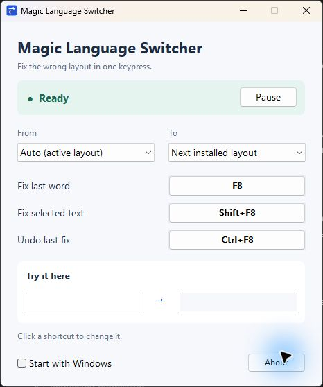

# Magic Language Switcher

[](https://github.com/siarheisinelnikau/magic-language-switcher/actions/workflows/ci.yml)
[](https://github.com/siarheisinelnikau/magic-language-switcher/releases/latest)
[](LICENSE)

A lightweight **Windows app** that fixes text typed in the wrong keyboard layout with one hotkey. Written in Rust, with a compact native interface and a **single portable EXE**.

`ghbdtn vbh` → `привет мир` is one example. Conversion uses the keyboard layouts installed in Windows, rather than a hardcoded English/Russian pair.

**[Download the latest release](https://github.com/siarheisinelnikau/magic-language-switcher/releases/latest)** · [Report an issue](https://github.com/siarheisinelnikau/magic-language-switcher/issues)



## Get started

1. Download `MagicLanguageSwitcher-v0.1.1-windows-x64.exe` from [Releases](https://github.com/siarheisinelnikau/magic-language-switcher/releases/latest).
2. Put it in a folder you want to keep and run it. No installer, .NET, browser engine, or VC++ redistributable is needed.
3. Leave the caret after a mistyped word and press **F8**, or select some text and press **Shift+F8**.

Requires **Windows 10 version 1607 or newer, or Windows 11, x64**. The release is unsigned.

## Shortcuts

| Default shortcut | Action |
| --- | --- |
| **F8** | Convert the last word, using the editor's word-selection behavior |
| **Shift+F8** | Convert the selected text |
| **Ctrl+F8** | Undo the last correction immediately, in the same editor |

**To change a shortcut:** click its button in settings, press the new combination, and release the keys to save. **Esc** cancels; **Backspace** restores that action's default. The buttons replace the previous shortcut labels without increasing the window size.

Use Ctrl, Alt, and/or Shift with a key, function keys (except Windows-reserved F12), or supported toggle keys such as Pause, Caps Lock, and Scroll Lock. Ordinary typing keys need Ctrl or Alt. Windows-key shortcuts are not supported. Avoid Ctrl+Alt combinations that overlap AltGr characters in your keyboard layout.

Each action needs a distinct shortcut. If a combination belongs to another app, or settings cannot be saved, the previous binding stays active. Recording ends when you leave the settings window. Preferences survive restart and changes to the conversion layouts.

Undo checks that the text before the caret still matches the last correction. If the text or caret has changed, it refuses to replace anything. A selection can contain up to **4,096 UTF-16 code units**, including line breaks and tabs.

The system tray icon shows the active language. It stays in the tray; nothing follows your mouse or text caret. Click the icon to open settings, or right-click for pause/resume and quit. Closing the settings window keeps the app running in the tray.

## Choose any installed keyboard layout

The **From** and **To** lists come from Windows and distinguish layout variants, such as US and Dvorak. Direct character mappings include Shift and AltGr states.

- **From → Auto (active layout)** detects the source by character coverage. If several layouts can produce the same letters, the active layout wins the tie.
- **To → Next installed layout** cycles from the detected source to the next layout in Windows' list. With two installed layouts, it switches between them.
- Choose explicit **From** and **To** entries for a fixed pair. This is useful for layouts sharing an alphabet, such as US QWERTY, German QWERTZ, and French AZERTY.

Add additional keyboards in Windows language settings, then reopen the app's settings window to refresh the lists. The app does not install languages or change the Windows language list. After a correction, it requests the destination layout for the active editor.

This is physical-key conversion, not translation or transliteration. **IME candidate composition** and **multi-key dead-key composition** cannot be reconstructed from committed text. Characters without a direct mapping remain unchanged. For ambiguous text, choose the source explicitly.

## A few settings

- **Pause** temporarily disables correction shortcuts; the language icon remains available.
- **Start with Windows** adds this EXE to your own user's startup entries. Keep the EXE in its final folder before enabling it; disable the option before moving or deleting it.
- Layout choices and shortcuts are saved in `%LOCALAPPDATA%\MagicLanguageSwitcher\settings.conf`.
- Run with `--background` to start directly in the tray.
- **About** contains the version, project link, and an expandable MIT license.

## Privacy and compatibility

The app works offline. It has no telemetry, network service, continuous keyboard hook, or typing log. A temporary keyboard hook runs only while you explicitly record a shortcut and is removed afterward. The app reads text only when you invoke a correction and keeps one undo record in memory.

Correction temporarily uses the clipboard to read selected text; multiline text is pasted back as plain text. Existing clipboard formats are duplicated and restored, and a newer clipboard value is not overwritten. Windows clipboard history or clipboard managers may retain the temporary text. Unusual app-owned clipboard formats can prevent a correction if they cannot be preserved.

Use an editable field that supports normal selection and copy/paste. Native password fields are excluded. Read-only controls, games, terminals, custom editors, and apps running as administrator may reject or reinterpret input. Text formatting is not preserved when replacing a rich-text selection. If a global shortcut is already registered by another app, choose a different combination in settings.

## Build from source

On Windows, install the [Rust MSVC toolchain](https://www.rust-lang.org/tools/install), Visual Studio C++ Build Tools, and the Windows SDK. Rust **1.88 or newer** is required; current stable Rust is recommended.

```powershell
git clone https://github.com/siarheisinelnikau/magic-language-switcher.git
cd magic-language-switcher
cargo build --release --locked
```

The executable is `target\release\magic-language-switcher.exe`. The MSVC runtime is linked statically through `.cargo/config.toml`; the icon, manifest, version information, and license are embedded. Only Windows system DLLs are required.

Create the same release assets used on GitHub:

```powershell
powershell -NoProfile -ExecutionPolicy Bypass -File tools/package-release.ps1
```

This builds a Windows x64 EXE, checks its PE imports, and writes the EXE and `SHA256SUMS.txt` to `artifacts\v0.1.1\`. To compare a downloaded file's checksum:

```powershell
Get-FileHash .\MagicLanguageSwitcher-v0.1.1-windows-x64.exe -Algorithm SHA256
```

## Tests

```powershell
cargo fmt --all -- --check
cargo clippy --locked --all-targets --all-features -- -D warnings
cargo test --locked --all-features
```

Pure conversion tests also run on Linux. The opt-in Windows desktop test starts an isolated native editor and the real app, exercises the actual global shortcuts, and restores the clipboard afterward. It requires an unlocked desktop, installed US English and Russian layouts for its known examples, and no running app instance:

```powershell
cargo test --locked --features desktop-tests --test desktop -- --ignored --test-threads=1 --nocapture
cargo test --locked --all-features failed_persistence -- --ignored --test-threads=1
```

## Project structure

| Path | Purpose |
| --- | --- |
| `src/layout.rs` | Layout-independent physical-key conversion and source selection |
| `src/shortcuts.rs` | Shortcut values, validation, and English key names |
| `src/platform/hotkeys.rs` | Registration, conflict rollback, and temporary shortcut recording |
| `src/platform/keyboard.rs` | Installed layout discovery and Windows keyboard tables |
| `src/platform/correction.rs` | Correction and verified undo |
| `src/platform/clipboard.rs` | Clipboard snapshots and restoration |
| `src/platform/ui.rs` | Native settings window, hotkeys, and tray language icon |
| `src/platform/about.rs` | Native About dialog and embedded license |
| `src/platform/smoke.rs` | Opt-in desktop integration checks |
| `tools/` | Portable EXE validation and release packaging |

The Windows mappings use [`MapVirtualKeyExW`](https://learn.microsoft.com/en-us/windows/win32/api/winuser/nf-winuser-mapvirtualkeyexw) and [`ToUnicodeEx`](https://learn.microsoft.com/en-us/windows/win32/api/winuser/nf-winuser-tounicodeex), with the non-mutating keyboard-state flag.

## Releases and contributions

CI checks formatting, Clippy, and tests on Windows and Linux. Bump the stable Cargo package version, add its release notes, and push to `main`; **Publish version** publishes the version only if it is not already public. The release job validates the source, builds the EXE, inspects DLL imports, creates checksums, and uploads assets to a draft before publishing. Version tags remain supported for manual releases. See [CONTRIBUTING.md](CONTRIBUTING.md).

Inspired by the one-key layout correction workflow of [Mahou](https://github.com/Sippelin/Mahou3). This is an independent implementation.

Licensed under [MIT](LICENSE).
